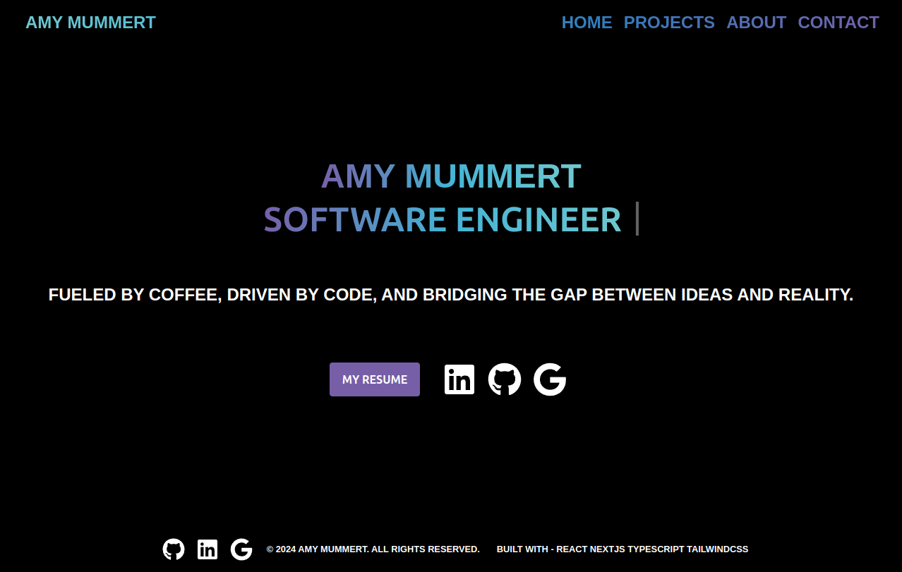
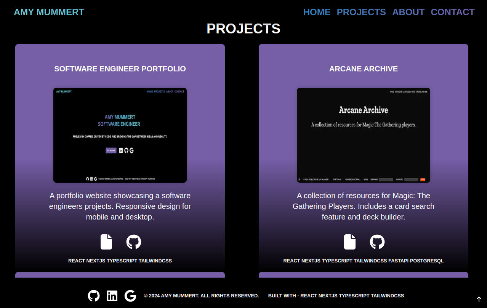
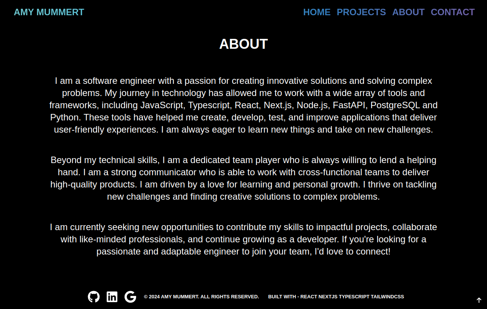
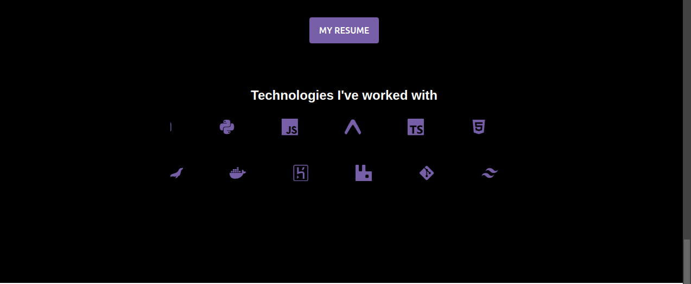
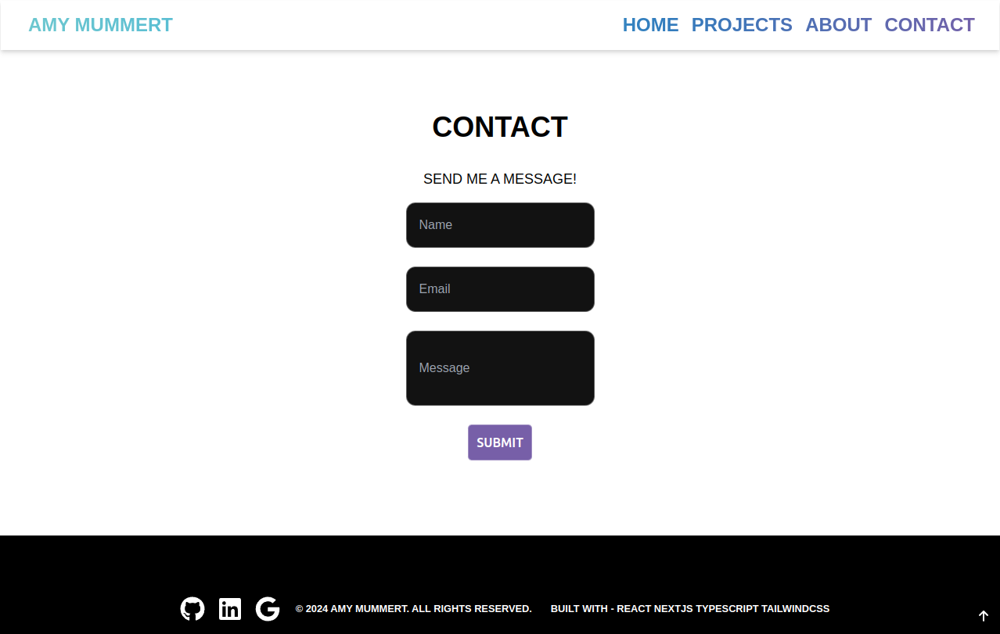

## Getting Started

This application is built with React, NextJS, Typescript, and TailwindCSS.

First, install dependencies & run the development server:
```bash
npm install
```

```bash
npm run dev
```

Open [http://localhost:3000](http://localhost:3000) with your browser to see the result.

## Introduction
The Software Engineering Portfolio is a showcase of my technical expertise and development projects.  This portfolio highlights my skills as a Front End Developer while demonstrating my proficiency in modern web development technologies.  
# Scope
This report will cover an in-depth analysis and documentation of the Software Engineering Portfolio.  It will define the purpose, features, tools & technologies, and development process of the application.  

The report will include:
- [Objectives](#objectives)
- [Target Audience](#target-audience)
- [Overview](#overview)
- [Feature Roadmap](#feature-roadmap)
- [Design Decisions](#design-decisions)
- [Tools & Technologies](#tools--technologies)
- [Challenges](#challenges)
- [Future Enhancements](#future-enhancements)
- [UI / UX Design](#ui--ux-design)
- [Conclusion](#conclusion)
- [References](#references)

## Objectives
The Software Engineer Portfolio is designed to highlight my technical expertise and streamline access to my professional accomplishments.  Whether for employers, collaborators, or clients, this portfolio serves as an essential tool for showcasing my capabilities as a Software Engineer, particularly in Front End Development.  

**The main objectives are:**
   - To provide a responsive, comprehensive, and visually engaging portfolio to showcase my projects, including descriptions, tech stacks, preview images and links to documentation and GitHub repositories.  
   - To offer a seamless and intuitive user experience through responsive design for both mobile and web devices.
   - To facilitate professional connections by providing quick access to my resume, GitHub, LinkedIn, and email, making networking and communication seamless.
   - To enable effortless communication with a contact form powered by EmailJS, allowing visitors to reach out directly without navigating away from the page.
   - Target Audience
   - The primary audience of the Software application includes:
   - Potential employers and Recruiters 
   - Collaborators and Industry Peers
   - Clients and Stakeholders
   - General Enthusiasts
## Overview

The Software Engineer Portfolio is a feature-rich platform designed to showcase my technical experience, completed and in progress projects,  and my design capabilities. This portfolio provides a clean user interface with a responsive design allowing employers, collaborators, and clients to have fluid experiences while interacting with my portfolio.

### Feature Roadmap
1. Landing Section: A visually dynamic page featuring animations, links to my resume, and professional profiles on LinkedIn, GitHub, and Gmail.
2. About Section: Provides a detailed overview of my skills, the technologies I've worked with, and quick access to my resume.
3. Projects Section: Interactive project cards displaying project names, descriptions, tech stacks, images, and links to GitHub repositories and documentation.
4. Contact Section: Includes a user-friendly contact form powered by EmailJS, enabling direct communication.
5. Responsive Design: Ensures optimal usability across devices, including desktops, tablets, and mobile phones.
6. Customization Options: Supports light and dark modes, allowing users to personalize their viewing experience.
7. Engaging Aesthetics: Vibrant color palette and smooth animations for a modern, professional look and feel.

## Tools & Technologies
1. IDEs/Editors/Debuggers
   - Pycharm 
2. Frameworks 
   - Frontend: React, Next.js 
   - Styling: TailwindCSS 
3. Languages
   - TypeScript
4. Package Managers
   - npm
5. Version Control / Continuous Integration / Deployment
   - Git / GitHub
   - Cloudflare Pages
6. Software Libraries
   - Frontend:
     - Form Handling: React Hook Form
     - Animations: Typing, Blinking, SlideIn, SlideDown
     - State Management: React - Global, Local, and Form
   - Backend:
     - Email Functionality: EmailJS
7. Deployment Tools
   - Cloudflare 
8. Development Tools
   - ESLint 
   - Prettier

## Design Decisions
### User Interface
The user interface design for the Software Engineering Portfolio aims to provide a visually appealing, responsive, and user-friendly experience to showcase my projects and skills.  
### Key Design Choices
### Layout
1. Landing Section - 
The landing page greets users with a clean and visually engaging header containing animated transitions.  
It includes a professional resume button, as well as icons for GitHub, LinkedIn, and Gmail with direct links for access.
2. About Section - 
Features a personal introduction, highlighting my skills.
A button to my resume appears here as well.
Icons for technologies are presented in a loop animation.
3. Projects Section - 
Each project is displayed in a card layout for easy readability using a grid layout.
Card Details include:
Project name
Description
An image 
Technology stack used
Links to GitHub repository and documentation
Features: Smooth animations when hovering 
4. Contact Section: 
A contact form implemented with EmailJS ensures secure, efficient communication.
Clear, well-labeled fields for name, email, and message input.
Submission feedback informs users if the message was successfully sent.
## Challenges
When I initially started this project, I began using locally scoped CSS modules. This choice was based on my ability and experience with locally scoped CSS. However, as I progressed, I found myself encountering some challenges that required adjustments to my code and found that TailwindCSS fit my requirements better. 
1. **Switching to TailwindCSS**
Halfway through the development, I decided to switch to TailwindCSS. This decision stemmed from a desire to leverage a more fluid approach that would allow for rapid styling adjustments without compromising maintainability. Animations and responsiveness were considered during my decision making.  However, transitioning to TailwindCSS presented challenges because it was a new tool for me, and I had to adjust to its unique way of thinking about design. 
2. **Managing State in React**
Another challenge was managing state effectively in React, especially with the integration of TailwindCSS. Initially, I relied on locally scoped CSS modules, which provided a straightforward way to manage styles. However, transitioning to TailwindCSS meant I had to restructure how I handled styles in the context of state management. This required rethinking how I could maintain a clean and maintainable state in my application, especially given the dynamic and responsive nature of TailwindCSS.
3. **Integrating with Responsive Design**
The shift to TailwindCSS also required reworking the responsive design strategies I had initially planned out and implemented using locally scoped CSS modules. I needed to adapt the layout and design system to work seamlessly across different screen sizes and devices.

Despite these challenges, the experience was invaluable in expanding my understanding of CSS methodologies and design systems. It pushed me to adapt quickly and learn new tools, ultimately leading to a more flexible and scalable portfolio design.
## Future Enhancements
1. Expanded Projects Section 
   - Detailed Project Overviews: Include deeper case studies for each project with technical breakdowns, challenges faced, and solutions implemented. 
   - Interactive Project Demos: Add interactive elements such as live demos. 
   - Client Testimonials and Feedback: Integrate sections where clients or team members can provide testimonials and feedback on projects.
2. Enhanced Search and Filtering for Projects
   - Advanced Filtering Options: Implement advanced search features that allow users to filter projects by technology stack, date, role, or specific keywords. This would make it easier for potential employers or collaborators to find relevant projects.
3. Improved Mobile Experience
   - Mobile Optimized UI Enhancements: Further refine mobile UI to ensure it’s as smooth and functional as the desktop version, with attention to touch interactions and mobile-first design principles.
4. Enhanced Documentation and Integration
   - Integrations: Include third-party tools for analytics, performance monitoring, or real-time feedback systems to track portfolio effectiveness and user engagement.
5. Expansion of Technologies and Skill Showcase
   - New Technologies and Frameworks: Regularly update the portfolio to include new technologies, frameworks, and tools that are in demand, showcasing continuous learning and growth.
6. Community and Social Features
   - Showcase Open Source Contributions: Highlight contributions to open-source projects or active involvement in the tech community, such as speaking engagements or workshops.

## UI / UX Design







## Conclusion
The software engineer portfolio serves as a dynamic and comprehensive representation of my skills, projects, and technical expertise. Designed with React, Next.js, TypeScript, and TailwindCSS, the portfolio not only highlights professional accomplishments but also demonstrates a strong grasp of software development and responsive design principles.
By incorporating features such as an animated landing page, intuitive navigation, detailed project showcases, and a seamless contact form, the portfolio provides an engaging experience for visitors. The addition of light and dark modes, a vibrant yet professional design, and responsive layouts ensures accessibility across all devices and user preferences.
## References
- Infinite Scroll Animation - https://codepen.io/ykadosh/pen/XWBKjEV
- Typing Animation - https://play.tailwindcss.com/q6LZjWKr97
